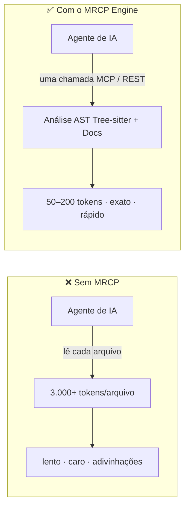
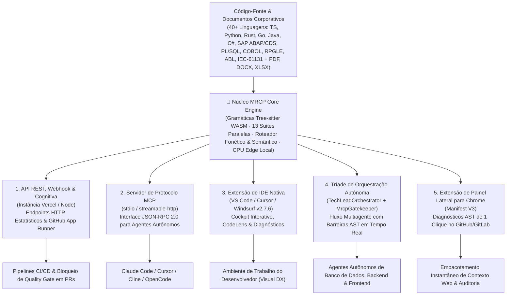

<div align="center">


# 🧠 MRCP Engine

### Contexto Determinístico de IA, Inteligência AST Poliglota & Arquitetura FinOps para IA

**Pare de alimentar seu agente de IA com código-fonte bruto. Forneça inteligência AST estruturada e determinística.**

[🇧🇷 Ler em Português](README.pt-BR.md) · [🇬🇧 English](README.md) · [📄 Whitepaper](Whitepaper.md) · [🤖 AI Guidelines](MRCP_AI_GUIDELINES.md)

[](https://www.npmjs.com/package/mrcp-engine)
[](https://marketplace.visualstudio.com/items?itemName=mrcp-engine.mrcp-vscode)
[](https://modelcontextprotocol.io)
[](https://github.com/faelscarpato/mrcp-engine/actions/workflows/ci.yml)
[](LICENSE)

<br/>

| 🌐 1. API REST & Cognitiva | 🔌 2. Servidor MCP | 🧩 3. Cockpit IDE Nativo | 🤖 4. Tríade Autônoma | 🌍 5. Extensão Chrome |
| :--- | :--- | :--- | :--- | :--- |
| Endpoints HTTP estatísticos, Webhooks do GitHub e Roteamento Semântico para quality gates em CI/CD. | Interface JSON-RPC 2.0 sem configuração fornecendo contratos AST e skills diretamente para agentes. | Dashboard de Cockpit interativo, CodeLens inline e alertas de segurança em tempo real no VS Code, Cursor e Windsurf. | Tech Lead autônomo, Agentes Operários e Gatekeeper AST em tempo real (`MrcpGatekeeper`). | Extensão de Painel Lateral (Manifest V3) injetando diagnósticos AST de 1 clique no GitHub e GitLab. |

<br/>

[Início Rápido](#-início-rápido-30-segundos) · [Arquitetura & Distribuição](#-cinco-formas-de-consumir-o-mrcp) · [Matriz WASM Poliglota](#-matriz-de-gramáticas-webassembly-poliglota-mais-de-40-linguagens) · [Por que o MRCP](#-por-que-o-mrcp-engine) · [Catálogo de Ferramentas](#-catálogo-de-ferramentas) · [Referência API REST](#-referência-da-api-rest) · [Extensão de IDE](#-extensão-de-ide-vs-code--cursor--windsurf) · [Extensão de Navegador](#-extensão-de-navegador-google-chrome--manifest-v3)

</div>

---

## O Problema

Toda vez que um agente de IA lê seu repositório abrindo arquivo por arquivo, ele paga o **"Imposto da IA"**: milhares de tokens desperdiçados, respostas mais lentas e alta probabilidade de alucinação sobre bases de código parcialmente lidas ou quebra de contratos entre camadas.

O **MRCP Engine** é uma camada de inteligência e FinOps determinística baseada em AST que se posiciona entre o seu repositório e o seu agente de IA. Em vez de despejar arquivos brutos na janela de contexto, ele analisa seu código e documentos corporativos uma única vez usando **Tree-sitter WebAssembly** na CPU local. Ele retorna schemas JSON estritamente estruturados — grafos de dependência arquitetural, auditorias de segurança, assinaturas de tipos exatas, alcançabilidade de código morto, contratos SQL/ORM, schemas de dados tabulares e barreiras de refatoração.



Nenhuma chamada de LLM é utilizada para análise estrutural. A análise puramente determinística transforma uma base de código inteira — desde monorepos modernos em TypeScript até sistemas legados em SAP ABAP, COBOL, Oracle PL/SQL e CLP industrial — em um pacote de contexto ultra-enxuto que seu agente consome imediatamente sem alucinações.

---

## ⚡ Início Rápido (30 segundos)

Auto-configure todos os IDEs e agentes de IA compatíveis com MCP instalados na sua máquina com um único comando:

```bash
npx mrcp-engine setup
```

Isso detecta automaticamente o seu ambiente e configura o servidor MCP em:

| | | | |
| :--- | :--- | :--- | :--- |
| 🟢 Claude Desktop | 🟢 Claude Code | 🟢 Cursor | 🟢 Windsurf |
| 🟢 VS Code | 🟢 Antigravity IDE | 🟢 Gemini CLI | 🟢 OpenCode |
| 🟢 Ollama (MCP) | 🟢 Codex | | |

### Configuração Manual

Adicione isto diretamente ao arquivo de configuração MCP do seu cliente:

```json
{
  "mcpServers": {
    "mrcp-engine": {
      "command": "npx",
      "args": ["-y", "mrcp-engine@latest"]
    }
  }
}
```

Ou conecte qualquer cliente compatível com HTTP remoto (Cursor, Windsurf, VS Code, Antigravity) diretamente ao endpoint em nuvem sem instalar dependências locais:

```json
{
  "mcpServers": {
    "mrcp-engine": {
      "url": "https://mrcp-engine.vercel.app/api/mcp",
      "transport": "streamable-http"
    }
  }
}
```

Não tem um cliente MCP disponível? Cada ferramenta também é exposta como um endpoint REST padrão `GET`/`POST`.

---

## 🎯 Cinco Formas de Consumir o MRCP

O MRCP Engine opera como um núcleo determinístico único (`@mrcp/core`) entregue através de cinco camadas de integração especializadas:



### 1. 🌐 Núcleo de API REST, Webhook & Cognitiva (Pipelines de CI/CD e Nuvem)

Cada ferramenta opera como um endpoint HTTP estático. Ele permite que serviços externos, scripts CLI personalizados e pipelines de integração contínua imponham limites arquiteturais e gerem contratos sem exigir tempos de execução locais:

- **URL Base:** `https://mrcp-engine.vercel.app`
- **Inspeção de Ferramenta Única:** `GET /api/code-health?repo=<url>`
- **Execução de Diagnóstico Completo:** `GET /api/full-analysis?repo=<url>`
- **Processamento Cognitivo Semântico & Fonético:** `POST /api/v2/cognitive/process` (utiliza `phoneticFilter`, `semanticRouter` e `graphEngine` para roteamento determinístico de intenções antes da invocação de LLM).
- **Quality Gate Reativo de CI/CD & Webhook do GitHub:** `POST /api/github/webhook` integra-se com o GitHub Actions e `github-app-runner` para bloquear PRs que quebrem regras, comparando complexidade ciclomática, dependências circulares e vazamentos de segurança antes do merge.

### 2. 🔌 Servidor de Protocolo MCP (Agentes de IA Autônomos)

Exposta todas as ferramentas analíticas e contratos de refatoração via Model Context Protocol (JSON-RPC 2.0):

- **Zero Configuração:** Execute `npx mrcp-engine setup` para autodetectar e aplicar patches em arquivos de configuração de agentes de codificação instalados.
- **Governança Ativa (`mrcp-skill-injector`):** Em vez de deixar a IA inspecionar arquivos aleatoriamente, o MRCP fornece micro-contratos delimitados com instruções explícitas de skill e proibições de modificação de arquivos, interrompendo alucinações no perímetro.
- **Execução direta via stdio:** `npx -y mrcp-engine@latest`

### 3. 🧩 Extensão de IDE Nativa (Experiência Visual do Desenvolvedor)

O cliente de UI oficial (`v2.7.6`) publicado no Visual Studio Marketplace. Ele oferece telemetria offline completa, rastreamento de ROI em tempo real, diagnósticos no painel de problemas e CodeLens a nível de função diretamente no seu editor.

### 4. 🤖 Tríade de Orquestração Autônoma (Tech Lead & Guardião AST)

Transforme a LLM do seu IDE em uma equipe de engenharia disciplinada governada por validação AST em tempo real sem custos extras de tokens de LLM:

```bash
npx mrcp-engine auto "Construir um gateway de pagamento multilocatário com Clean Architecture"
```

- **O Cérebro (`TechLeadOrchestrator`)**: Realiza pesquisas na Web (`mrcp_web_search` & scraper), decompõe especificações de alto nível em rigorosos grafos de dependência de tarefas e gera contratos de execução.
- **Trabalhadores Especializados (`AgentManager` / `BaseAgent`)**: Emite diretrizes estruturadas (`.mrcp/ACTIVE_PROMPT_DIRECTIVE.md`) para agentes de Banco de Dados (`DatabaseAgent`), Backend (`BackendAgent`) e Frontend (`FrontendAgent`) que guiam nativamente os agentes de IDE (Antigravity, Cursor, Claude Code).
- **A Espinha Dorsal de QA (`MrcpGatekeeper`)**: Monitora o sistema de arquivos em tempo real. Avalia todas as modificações usando o Motor AST do MRCP (`detectArchitectureDrift`, `calculateCodeHealth`, detecção de ciclos de Tarjan, regressões de assinaturas de tipos). Rejeita mutações defeituosas com crítica instantânea (`GATEKEEPER_CRITIQUE.md`) ou confirma iterações válidas (`GATEKEEPER_APPROVAL.md`).

> 📖 **Documentação Completa da Tríade de Orquestração & Governança de IA**:
>
> - [Especificação Técnica & Arquitetural do Orquestrador](docs/ORCHESTRATOR_ARCHITECTURE_AND_SPECS.md)
> - [Diretrizes de Agentes de IA do MRCP](MRCP_AI_GUIDELINES.md)
> - [Whitepaper do Sistema](Whitepaper.md)

### 5. 🌍 Extensão de Navegador (Painel Lateral do Google Chrome)

Injeta um botão interativo `⚡ MRCP Cockpit` diretamente nos cabeçalhos do GitHub e GitLab, abrindo um Painel Lateral nativo do Chrome (`sidepanel.js`) para pontuação instantânea da saúde do repositório e empacotamento de contexto de IA com 1 clique.

---

## 🧬 Matriz de Gramáticas WebAssembly Poliglota (Mais de 40 Linguagens e Formatos Corporativos)

Ao contrário de ferramentas de IA genéricas restritas a pilhas web básicas, o MRCP Engine é distribuído com binários pré-compilados do **Tree-sitter WebAssembly (`.wasm`)** (`public/tree-sitter/`) e pacotes de gramática personalizados (`packages/tree-sitter-*`) que cobrem pilhas modernas em nuvem, sistemas legados críticos de missão em ERPs/Mainframes, automação industrial e finanças quantitativas:

| Categoria | Linguagens Suportadas & Motores WASM Pré-Compilados |
| :--- | :--- |
| **🌐 Web Moderna, Nuvem & Sistemas** | TypeScript (`typescript.wasm`), TSX (`tsx.wasm`), JavaScript (`javascript.wasm`), Python (`python.wasm`), Go (`go.wasm`), Rust (`rust.wasm`), Java (`java.wasm`), C (`c.wasm`), C++ (`cpp.wasm`), C# (`c_sharp.wasm`), Swift (`swift.wasm`), Kotlin (`kotlin.wasm`), PHP (`php.wasm`), Ruby (`ruby.wasm`), Web3 / Solidity (`web3.wasm`), Bicep (`bicep.wasm`), Pipeline (`pipeline.wasm`) |
| **🏛️ ERP Corporativo, Banco de Dados & Mainframe** | **SAP ABAP** (`sap_abap.wasm` / `abap.wasm`), **SAP CDS** (`sap_cds.wasm` / `cds.wasm`), **Oracle PL/SQL** (`oracle_plsql.wasm` / `plsql.wasm` / `oracle.wasm`), **T-SQL** (`tsql.wasm`), **COBOL** (`cobol.wasm`), **IBM RPGLE** (`rpgle.wasm`), **Mainframe JCL** (`jcl.wasm`), **Progress OpenEdge ABL** (`openedge_abl.wasm` / `abl.wasm`), **Salesforce Apex** (`apex.wasm`), **InterSystems ObjectScript** (`objectscript.wasm`), **Adabas Natural** (`natural.wasm`), **Delphi / Pascal** (`pascal.wasm`), **VBA** (`vba.wasm`), **ColdFusion CFML** (`cfml.wasm`) |
| **🏭 Automação Industrial, CAD & Hardware** | **CLP IEC 61131-3** (`iec61131.wasm`), **Texto Estruturado (Structured Text)** (`structured_text.wasm`), **Siemens SCL** (`scl.wasm`), **VHDL** (`vhdl.wasm`), **Modelica** (`modelica.wasm`), **OpenSCAD** (`openscad.wasm`) |
| **📈 Finanças Quantitativas, BI & Scripting** | **PowerQuery M** (`powerquery_m.wasm` / `powerquery.wasm`), **DAX** (`dax.wasm`), **SAS** (`sas.wasm`), **KDB+ / Q** (`q.wasm`), **MetaTrader MQL5** (`mql5.wasm`), **TradingView PineScript** (`pine.wasm`), **AutoHotkey** (`ahk.wasm`), **AutoIt** (`autoit.wasm`), **AppleScript** (`applescript.wasm`), **ActionScript** (`actionscript.wasm`), **Verse** (`verse.wasm`), **Pawn** (`pawn.wasm`) |
| **📄 Inteligência de Documentos Corporativos** | **PDF** (`pdf-parser.ts`), **Microsoft Word DOCX** (`docx-parser.ts`), **Excel XLSX / XLS** (`xlsx-parser.ts`), **CSV / TSV Tabular** (`tabular-parser.ts`), **Markdown** (`markdown-parser.ts`), **Arquivos ZIP** (`zip-extractor.ts`), **JSON / YAML / XML / LOG** (`structured.ts`) |

---

## 🤔 Por que o MRCP Engine?

| Recurso | Ingestão de Contexto Bruto (Context Stuffing) | MRCP Engine |
| :--- | :--- | :--- |
| **Estratégia de Análise** | A LLM rele todo o texto bruto do arquivo | Análise AST determinística via Tree-sitter WASM |
| **Custo de Tokens** | ~3.000+ tokens por arquivo médio | ~50–200 tokens por resposta estruturada |
| **Consistência** | Varia por prompt; sujeito a alucinações | Schema JSON estritamente tipado e invariante |
| **Escopo do Repositório** | Inspeção linear (um arquivo por vez) | Grafo de dependência de todo o repositório em uma única chamada |
| **Suporte a Legado & Industrial** | Falha em ABAP, COBOL, PL/SQL, RPGLE, IEC-61131 | Extração AST WASM nativa em mais de 40 linguagens |
| **Ativos Não-Código** | Ignorados ou não analisados | CSV, DOCX, XLSX, PDF, JSON, YAML, XML via `mrcp_document_analyzer` |
| **Segurança & Governança** | Suposições passivas | Detecção OWASP integrada, auditoria de segredos e barreiras do `MrcpGatekeeper` |

### 📊 Telemetria Comprovada & ROI (Ground Truth do Cockpit)

Testado em bases de código corporativas, o MRCP substitui a ingestão bruta de força bruta por compressão AST determinística:

| Métrica | Ingestão Bruta (Linha de Base) | MRCP Engine (Pacote AST) | Otimização Líquida |
| :--- | :--- | :--- | :--- |
| **Volume Analisado** | 1.936.508 tokens | **594 tokens** | **~98% de Redução de Contexto** |
| **Custo por Análise (GPT-4o)** | ~$5,82 USD | **~$0,002 USD** | **~$5,81 USD economizados / consulta** |
| **Latência de Análise** | Vários minutos (geração de tokens em GPU) | **< 2,0s (Execução em CPU local)** | **Zero Sobrecarga em Nuvem** |
| **Precisão** | Heurísticas probabilísticas (risco de alucinação) | **13 suítes determinísticas paralelas** | **Ground Truth Determinístico** |

> **Projeção FinOps Corporativa:** Para uma equipe de engenharia com 10 desenvolvedores realizando 20 consultas arquiteturais por dia, o MRCP evita mais de **$25.000 USD/mês** em gastos redundantes com LLMs em nuvem, mantendo o código-fonte 100% offline.

---

## 🛠 Catálogo de Ferramentas

<details open>
<summary><b>1. 🏗️ Motor Principal & Inteligência de Documentos</b></summary>

| Ferramenta | Endpoint | Descrição |
| :--- | :--- | :--- |
| `analyze_repository` | `GET /api/analyze?repo=<url>` | Grafo AST estrutural: nós (arquivos/módulos/funções), arestas (dependências), complexidade ciclomática, acoplamento e pontos críticos (hotspots). |
| `mrcp_document_analyzer` | `GET /api/document-analyzer?repo=<url>` | Analisador determinístico para arquivos **não-código**: CSV, TSV, TXT, MD, DOCX, XLSX, XLS, PDF (camada de texto), JSON, YAML, XML, LOG. Gera grafos de conhecimento, interfaces TypeScript tabulares, Índice de Qualidade de Documentos (0–100) e validação de links sem OCR. |
| `get_repository_skills_contract` | `GET /api/skills?repo=<url>` | Contratos de refatoração para arquivos críticos (complexidade > 50), impondo uma Política de Zero Regressão em assinaturas públicas. |
| `mrcp_run_full_repository_suite` | `GET /api/full-analysis?repo=<url>` | Executa todas as 13 ferramentas centrais de análise em paralelo e grava um sumário de diagnóstico executivo (`mrcp-analysis.json`). |

</details>

<details open>
<summary><b>2. ⚡ Descarregamento de Alta Eficiência para Agentes</b></summary>

| Ferramenta | Endpoint | Descrição |
| :--- | :--- | :--- |
| `mrcp_api_contract_generator` | `GET /api/api-contract?repo=<url>` | Extrai definições de rotas e manipuladores (Next.js, Express, Fastify, Hono, FastAPI, Flask) para especificações OpenAPI 3.0.3 e SDKs TypeScript tipados. |
| `mrcp_monorepo_package_graph_analyzer` | `GET /api/monorepo-graph?repo=<url>` | Mapeia topologias de pacotes pnpm, Turborepo, Lerna e Nx, árvores de dependência, ordem de build e impacto de diffs. |
| `mrcp_docstring_api_doc_generator` | `GET /api/doc-generator?repo=<url>` | Gera TSDoc, JSDoc, docstrings em Python e tabelas de referência em Markdown para símbolos públicos não documentados. |
| `mrcp_ast_refactor_applier` | `POST /api/refactor-applier` | Aplica refatoração AST em lote (renomeação de símbolos, extração de interfaces, atualização de caminhos de importação) em dezenas de arquivos em ~30ms. |
| `mrcp_type_signature_extractor` | `GET /api/type-signature-extractor?repo=<url>` | Extrai estritamente assinaturas de tipos, declarações `.d.ts` e schemas Zod removendo os corpos de implementação (reduzindo de ~3.000 para ~50 tokens). |
| `mrcp_git_diff_semantic_summarizer` | `POST /api/diff-summarizer` | Remove ruídos de formatação e espaçamento de diffs, agrupando modificações semânticas em nível AST. |
| `mrcp_dependency_compatibility_resolver` | `GET /api/dependency-resolver?package=<name>` | Verifica compatibilidade SemVer, conflitos de dependências de pares e riscos de breaking changes contra o registro ativo do npm. |
| `mrcp_dead_code_pruner` | `GET /api/dead-code-pruner?repo=<url>` | Análise de alcançabilidade AST identificando exportações não utilizadas, variáveis órfãs e importações não referenciadas. |
| `mrcp_sql_schema_orm_contract_generator` | `GET /api/sql-orm-contract?repo=<url>` | Analisa definições do Prisma, Drizzle, TypeORM, DDL SQL bruto transformando-as em representações de schema tipadas. |

</details>

<details open>
<summary><b>3. 🛡️ Engenharia Preditiva & Auditoria de Segurança</b></summary>

| Ferramenta | Endpoint | Descrição |
| :--- | :--- | :--- |
| `mrcp_code_metrics_health_scorer` | `GET /api/code-health?repo=<url>` | Índice de Manutenibilidade (0–100), notas de dívida técnica (A–F), distribuição de carga cognitiva e matrizes de prioridade de refatoração. |
| `mrcp_env_secret_contract_validator` | `GET /api/env-validator?repo=<url>` | Mapeia o uso de `process.env` / `os.environ`, valida paridade contra `.env.example`, sinaliza riscos de vazamento no lado do cliente e emite schemas Zod. |
| `mrcp_impact_analysis` | `POST /api/impact-analysis` | Calcula o raio de explosão (blast radius) AST identificando todos os arquivos downstream e testes afetados por um conjunto de alterações antes do commit. |
| `mrcp_security_compliance_audit` | `GET /api/security-audit?repo=<url>` | Audita vulnerabilidades OWASP, credenciais hardcoded, execuções de shell inseguras, dependências depreciadas e exposição de licença copyleft (GPL). |
| `mrcp_architectural_drift_detector` | `GET /api/architecture-drift?repo=<url>` | Descobre desvios arquiteturais, cadeias de importação circular (algoritmo de Tarjan) e violações de fronteira de camadas da Clean Architecture. |
| `mrcp_auto_test_coverage_gap_finder` | `GET /api/test-gap-analysis?repo=<url>` | Mapeia caminhos de código complexos e não testados gerando stubs de testes unitários Vitest/Jest estruturados. |
| `mrcp_context_pruning_pack` | `GET /api/context-pack?repo=<url>&task=<desc>` | Fatiamento de contexto AST sensível à tarefa que descarta arquivos não relacionados gerando redução de 60–90% de tokens. |

</details>

<details>
<summary><b>4. 🌐 Pesquisa Web & Engenharia Reversa</b></summary>

| Ferramenta | Endpoint | Descrição |
| :--- | :--- | :--- |
| `mrcp_web_search` | `GET /api/web-search?q=<query>` | Pesquisa web semântica sem chave de API. |
| `mrcp_web_scrape` | `GET /api/scrape?url=<url>` | Extração limpa de corpo de página removendo navegação, estilos, scripts e anúncios. |
| `mrcp_web_smart_search` | `GET /api/smart-search?q=<query>&topN=2` | Consulta a mecanismos de busca combinada com raspagem de contexto profundo dos principais resultados. |
| `mrcp_clone_page` | `GET/POST /api/clone?url=<url>` | **PageCloner Pro:** Desconstrói interfaces web em tokens de design, árvores de componentes DOM, layouts semânticos e prompts para reconstrução de código. |

</details>

<details>
<summary><b>5. 👥 Triagem & Recrutamento Técnico</b></summary>

| Ferramenta | Descrição |
| :--- | :--- |
| `mrcp_triage_parse_resume` | Extração determinística de competências técnicas, anos de experiência e escopo de projetos de perfis de candidatos em PDF/DOCX. |
| `mrcp_triage_score_candidate` | Gera uma pontuação de qualificação ponderada combinando as habilidades do candidato com os requisitos de arquitetura do repositório. |
| `mrcp_triage_generate_hr_report` | Formata um relatório executivo de triagem técnica com perguntas de entrevista direcionadas aos pontos fracos do candidato. |

</details>

---

## 🌐 Referência da API REST

Cada analisador do motor e processador cognitivo é acessível como um endpoint HTTP padrão estático:

```bash
curl "https://mrcp-engine.vercel.app/api/analyze?repo=https://github.com/your-org/your-repo"
```

| Endpoint | Método | Descrição |
| :--- | :--- | :--- |
| `/api/analyze?repo=<url>` | `GET` | Grafo AST estrutural, arestas de dependência e complexidade ciclomática. |
| `/api/document-analyzer?repo=<url>` | `GET` | Grafo de conhecimento de documentos não-código, schemas tabulares e pontuação DQI. |
| `/api/skills?repo=<url>` | `GET` | Contratos de refatoração acionáveis para arquivos de hotspot identificados. |
| `/api/api-contract?repo=<url>` | `GET` | Extração completa de rotas, schema OpenAPI 3.0 e SDK TypeScript tipado. |
| `/api/code-health?repo=<url>` | `GET` | Índice de Manutenibilidade, pontuações de dívida cognitiva e estimativas de esforço de refatoração. |
| `/api/env-validator?repo=<url>` | `GET` | Validação de `.env` em tempo de execução, detecção de vazamento de segredos e schemas Zod. |
| `/api/monorepo-graph?repo=<url>` | `GET` | Árvore de dependência de workspace entre pacotes e ordem de build ideal. |
| `/api/doc-generator?repo=<url>` | `GET` | Extração automática JSDoc/TSDoc e tabelas de API em Markdown. |
| `/api/refactor-applier` | `POST` | Renomeação de símbolos AST em lote, extrações de interface e remapeamento de imports. |
| `/api/type-signature-extractor?repo=<url>` | `GET` | Extração de declarações e assinaturas de tipos sem corpos de implementação. |
| `/api/diff-summarizer` | `POST` | Categorização de diffs Git semânticos agrupados por limites AST. |
| `/api/dependency-resolver?package=<name>` | `GET` | Resolução SemVer e avaliação de conflitos de dependências de pares. |
| `/api/dead-code-pruner?repo=<url>` | `GET` | Detecção de exportações não referenciadas, funções e variáveis mortas. |
| `/api/sql-orm-contract?repo=<url>` | `GET` | Extração de schema de Prisma, Drizzle, TypeORM e DDL SQL bruto. |
| `/api/impact-analysis` | `POST` | Análise de raio de explosão de alterações (`body: { repoUrl, modifiedFiles }`). |
| `/api/security-audit?repo=<url>` | `GET` | Auditoria de segurança estática, dependências vulneráveis e verificações de licença GPL. |
| `/api/architecture-drift?repo=<url>` | `GET` | Detecção de dependência circular e auditorias de fronteira de camadas arquiteturais. |
| `/api/test-gap-analysis?repo=<url>` | `GET` | Descoberta de lacunas de cobertura com stubs de testes unitários gerados. |
| `/api/context-pack?repo=<url>&task=<desc>` | `GET` | Pacote de contexto podado para tarefas específicas de implementação de agentes. |
| `/api/clone?url=<url>` | `GET/POST` | **PageCloner Pro:** Extração de tokens, detalhamento de layout e prompt de reconstrução. |
| `/api/page-prompt?url=<url>` | `GET` | Geração de prompt em Markdown para reconstruir páginas web existentes. |
| `/api/full-analysis?repo=<url>` | `GET` | Execução paralela em chamada única de todos os 13 motores diagnósticos centrais. |
| `/api/v2/cognitive/process` | `POST` | Roteador semântico cognitivo, filtro fonético e pipeline de execução de grafos. |
| `/api/github/webhook` | `POST` | Webhook automatizado do GitHub App para quality gates AST em Pull Requests. |
| `/api/mcp` | `POST` | Endpoint HTTP de streaming central JSON-RPC 2.0 para agentes MCP remotos. |

---

## 🧩 Extensão de IDE (VS Code · Cursor · Windsurf)

O cliente de IDE oficial traz a telemetria determinística do MRCP diretamente para o ambiente de edição do desenvolvedor.

<div align="center">
  <a href="https://marketplace.visualstudio.com/items?itemName=mrcp-engine.mrcp-vscode">
    
  </a>
</div>

### Instalação

- **Interface do Marketplace:** Abra a aba de Extensões (`Ctrl+Shift+X` / `Cmd+Shift+X`) no VS Code, Cursor ou Windsurf e pesquise por **`mrcp-engine`**.
- **CLI do VS Code:**

```bash
code --install-extension mrcp-engine.mrcp-vscode
```

- **CLI do Cursor:**

```bash
cursor --install-extension mrcp-engine.mrcp-vscode
```

### Recursos Nativos do Editor

#### 1. 🏥 Cockpit Webview Interativo (Dashboard)

Executa 13 suítes AST paralelas em ~2 segundos sobre o workspace local na inicialização com zero chamadas de rede:

- **Telemetria FinOps & ROI de Tokens:** Exibe a economia exata de tokens e dólares por consulta comparando tamanhos de arquivos brutos da linha de base contra o contexto empacotado por AST (por exemplo, **1.936.508 tokens brutos compactados para 594 tokens AST**, entregando **~98% de redução de contexto** e economizando **~$5,81 USD** por consulta).
- **Pontuação de Saúde & Manutenibilidade:** Índice de Manutenibilidade padrão SEI em tempo real (0–100), médias de complexidade ciclomática e notas de dívida técnica (Nota A–F).
- **Matriz de Pontos Críticos & God Modules:** Links diretos para saltar para funções de alta complexidade (>50 de complexidade) e dependências emaranhadas.
- **Inteligência Documental (DQI):** Pontuação em tempo real e inferência de schemas em arquivos não-código (PDF, DOCX, XLSX, CSV, Markdown).

#### 2. ⚡ CodeLens Inline por Nível de Função

Ativo em mais de 40 linguagens suportadas, incluindo TypeScript, JavaScript, Python, Go, Rust, Java, C/C++, PHP, Ruby, C#, Swift, Kotlin, SAP CDS, SAP ABAP, Oracle PL/SQL, COBOL, RPGLE, OpenEdge ABL, IEC 61131-3, Pascal, VBA, Apex e muito mais:

- **Indicadores Visuais de Complexidade:** Exibe emblemas de complexidade de função em tempo real logo acima das assinaturas (ex: `⚡ MRCP: Complexidade 1 (Baixa 🟢)` vs `⚡ MRCP: Complexidade 20+ (Alta 🔴)`).
- **📋 Copiar para IA (Ação de 1 Clique):** Extrai exclusivamente a assinatura da função de destino, tipos de parâmetros e dependências AST imediatas em um micro-contrato higienizado, impedindo que a IA ingira ou modifique seções não relacionadas da base de código.

#### 3. 🛡️ Barra Lateral de Atividades (6 Visões Dedicadas)

- **⚡ Ações Rápidas:** Executa suítes completas, copia contexto otimizado para tokens, dispara varreduras de segurança e exporta relatórios consolidados em Markdown (`MRCP_DIAGNOSTIC_REPORT.md`).
- **🏥 Saúde & Métricas:** Notas de saúde em tempo real, métricas do Índice de Manutenibilidade e distribuição de complexidade.
- **🛡️ Segurança & Segredos (.env):** Descobre variáveis de ambiente não vinculadas e chaves hardcoded com avisos diretos direcionados ao painel de Problemas do VS Code.
- **🏗️ Arquitetura & Dependências:** Descoberta de imports circulares, árvores de rotas do Next.js/FastAPI e grafos de pacotes.
- **🧪 Lacunas de Testes & Código Morto:** Análise de alcançabilidade destacando variáveis mortas, exportações não utilizadas e funções de alta complexidade não verificadas.
- **📄 Inteligência Documental:** Validação de schemas tabulares e Indexação de Qualidade de Documentos (DQI).

#### 4. ⚙️ Configurações da Extensão

Configure limites de varredura e recursos em `.vscode/settings.json`:

```json
{
  "mrcp.autoAnalyzeOnSave": false,
  "mrcp.enableCodeLens": true,
  "mrcp.enableNativeDiagnostics": true,
  "mrcp.maxFiles": 2000
}
```

### Atalhos da Paleta de Comandos (`Ctrl+Shift+P` / `Cmd+Shift+P`)

| Comando | Ação |
| :--- | :--- |
| `mrcp.startAutonomous` | Inicializa a Tríade de Orquestração Autônoma (Tech Lead & Guardião de QA Gatekeeper). |
| `mrcp.runFullSuite` | Executa a suíte de diagnóstico completa de 13 ferramentas em segundo plano. |
| `mrcp.openDashboard` | Inicia o dashboard interativo MRCP Cockpit e o visualizador AST. |
| `mrcp.copyAiContext` | Copia o pacote de contexto AST otimizado para tokens (~95–98% de redução de tokens). |
| `mrcp.copyFileContext` | Copia a assinatura estrutural e o contrato de tipos do arquivo ativo. |
| `mrcp.auditSecurity` | Executa inspeção de segurança estática e varredura por chaves `.env` vazadas. |
| `mrcp.detectDeadCode` | Executa análise de alcançabilidade para sinalizar funções e exportações não utilizadas. |
| `mrcp.validateEnv` | Valida declarações de variáveis de ambiente contra referências da base de código. |
| `mrcp.exportReport` | Gera um relatório de diagnóstico consolidado em Markdown (`MRCP_DIAGNOSTIC_REPORT.md`). |
| `mrcp.refresh` | Reexecuta a análise AST incremental e atualiza as exibições de UI. |

---

## 🌐 Extensão de Navegador (Google Chrome — Manifest V3)

O diretório [`mrcp-chrome-extension/`](mrcp-chrome-extension/README.md) fornece uma extensão nativa de Painel Lateral para Chrome com um pacote de instalação pré-construído:

- **Cockpit em Painel Lateral no Chrome:** Diagnósticos arquiteturais direto no navegador sem interromper o fluxo de páginas.
- **Detecção de Aba em Tempo Real:** Detecta repositórios abertos no GitHub e GitLab com o botão de ação rápida injetado automaticamente `⚡ MRCP Cockpit`.
- **Telemetria de Diagnóstico de 1 Clique:** Pontuação de Saúde, Índice de Manutenibilidade SEI, God Modules, Lacunas de Testes e Segredos Expostos.
- **Empacotador de Contexto para IA:** Reduz a carga útil de contexto da LLM em até ~95% para colagem instantânea no ChatGPT, Claude, Gemini ou Cursor.
- **Instalador Pré-Empacotado:** Baixe [`mrcp-chrome-extension-v2.6.1.zip`](mrcp-chrome-extension/mrcp-chrome-extension-v2.6.1.zip) e carregue como descompactado em `chrome://extensions`.

Consulte o [Guia Passo a Passo de Instalação da Extensão para Chrome](mrcp-chrome-extension/README.md).

---

## 📡 Instância Ativa (Live Instance)

Uma instância em nuvem hospedada está ativa para avaliação sem necessidade de configuração local:

**`https://mrcp-engine.vercel.app`**

```bash
curl "https://mrcp-engine.vercel.app/api/code-health?repo=https://github.com/facebook/react"
```

---

## 🗺 Roadmap

- [x] Suíte de diagnóstico com 13 ferramentas e execução paralela
- [x] Extensão nativa para VS Code / Cursor / Windsurf publicada no Visual Studio Marketplace (v2.7.6 com ativos PNG e SVG dedicados)
- [x] Inteligência documental e extração de schemas para repositórios não-código (PDF, DOCX, XLSX, CSV)
- [x] Gramáticas estendidas corporativas, de mainframe, industriais e universais (mais de 40 gramáticas Tree-sitter WebAssembly integradas: SAP ABAP, SAP CDS, Oracle PL/SQL, COBOL, RPGLE, OpenEdge ABL, IEC 61131-3, Swift, C#, Kotlin, Apex, Pascal, VBA, SCL, Web3, etc.)
- [x] Tríade de Orquestração Multiagente Autônoma (`TechLeadOrchestrator` + `MrcpGatekeeper`)
- [ ] **v3**: Chat Híbrido In-IDE com roteamento inteligente de modelos (BYOK + proxies de camada gratuita via `semanticRouter` & `phoneticFilter`)
- [ ] **v3**: Otimização nativa de cache de prompt (prefixos de sistema estáticos e sufixos AST dinâmicos)
- [ ] Recuperação estruturada de arquivos sob demanda usando metadados de índice AST

---

## 🤝 Contribuindo

Contribuições, relatos de bugs e solicitações de recursos são bem-vindos. Revise [CONTRIBUTING.md](CONTRIBUTING.md) para configuração de ambiente local e [CODE_OF_CONDUCT.md](CODE_OF_CONDUCT.md) para as diretrizes da comunidade.

Se o MRCP Engine reduzir seus gastos com tokens ou estabilizar seus fluxos de trabalho com IA, considere dar uma estrela no repositório.

## 📄 Licença

[MIT](LICENSE) © faelscarpato

---

<div align="center">

### ⭐ Histórico de Estrelas (Star History)

[](https://www.star-history.com/?repos=faelscarpato%2Fmrcp-engine&type=date&legend=top-left)
</div>