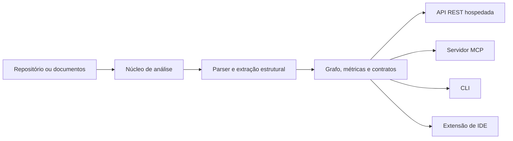

# Arquitetura do MRCP Engine

O projeto combina um núcleo de análise com diferentes interfaces de consumo. Uma mesma pergunta pode entrar pela API, MCP, CLI ou extensão; o local onde o código é lido depende do caminho escolhido.

## Núcleo de análise

O pacote `@mrcp/core` contém o pipeline e as análises: construção de grafo, saúde do código, segurança, desvios arquiteturais, lacunas de testes, variáveis de ambiente, contratos de API/SQL, código não utilizado e inteligência documental. A extração estrutural usa parsers e gramáticas Tree-sitter quando aplicáveis; formatos de documentos seguem parsers próprios.

O resultado é estruturado, mas depende do conteúdo que foi encontrado e processado. Limites de arquivos, tamanho, acesso e tempo podem reduzir a cobertura; os relatórios devem preservar avisos e limitações.

## Interfaces e local de execução

| Interface | Onde começa | Comportamento a considerar |
| --- | --- | --- |
| API REST hospedada | Serviço em `mrcp-engine.vercel.app` | Analisa alvos que o serviço consegue acessar; não lê o disco do cliente. |
| MCP HTTP hospedado | Endpoint `/api/mcp` | Expõe ferramentas MCP via HTTP e permite descobrir o catálogo publicado. |
| MCP stdio do pacote | Processo iniciado pelo cliente MCP | Usa transporte local stdio, mas handlers podem encaminhar chamadas à API hospedada. |
| CLI com URL GitHub | Processo CLI + serviço hospedado | Executa a suíte remota e grava relatórios no diretório de trabalho, salvo `--no-save`. |
| CLI com caminho local | Processo CLI + core local | Executa a suíte local e grava seus relatórios; requer o core compilado no checkout-fonte. |
| Extensão de IDE | Workspace do editor | A extensão analisa o workspace local e mostra resultados em visualizações e comandos próprios. |

## Como interpretar as saídas

- **Grafo e relações:** ajudam a localizar módulos, dependências e áreas a revisar; não representam prova formal da arquitetura.
- **Métricas de saúde:** servem para priorização comparativa, não como uma nota universal de qualidade.
- **Auditoria estática:** pode encontrar padrões suspeitos, mas não substitui testes dinâmicos ou revisão especializada.
- **Contratos e contexto:** são recortes baseados nos arquivos reconhecidos e devem ser conferidos contra a implementação.
- **Etapas indisponíveis:** quando uma análise não consegue produzir dados, alguns campos podem ser `null`; não se deve preenchê-los por inferência.

## Documentação técnica

- [Especificação do orquestrador](/docs/ORCHESTRATOR_ARCHITECTURE_AND_SPECS)
- [Diretrizes para agentes de IA](/MRCP_AI_GUIDELINES)
- [Whitepaper](/Whitepaper)
- [Referência MCP](/docs/reference/mcp-tools)
